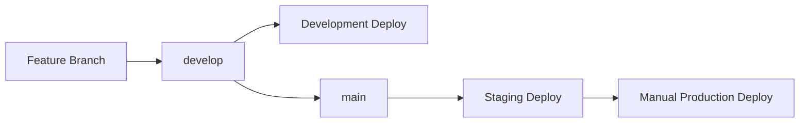

# デプロイメントガイド

## 概要

Commentiaプロジェクトは3つの環境（Development、Staging、Production）に段階的にデプロイされます。

## 環境構成

### Development (dev)
- **ブランチ**: `develop`
- **自動デプロイ**: 有効
- **URL**: `https://dev.commentia.example.com`
- **用途**: 開発中機能のテスト

### Staging (staging)
- **ブランチ**: `main`
- **自動デプロイ**: 有効
- **URL**: `https://staging.commentia.example.com`
- **用途**: 本番前の最終テスト

### Production (prod)
- **ブランチ**: `main`
- **自動デプロイ**: 無効（手動トリガー）
- **URL**: `https://commentia.example.com`
- **用途**: 本番環境

## GitHub Secrets設定

### AWS認証情報

各環境用のAWS認証情報を設定してください：

#### Development
```
AWS_ACCESS_KEY_ID_DEV=AKIA...
AWS_SECRET_ACCESS_KEY_DEV=...
```

#### Staging
```
AWS_ACCESS_KEY_ID_STAGING=AKIA...
AWS_SECRET_ACCESS_KEY_STAGING=...
STAGING_DOMAIN_NAME=staging.commentia.example.com
STAGING_CERTIFICATE_ARN=arn:aws:acm:us-east-1:123456789012:certificate/...
```

#### Production
```
AWS_ACCESS_KEY_ID_PROD=AKIA...
AWS_SECRET_ACCESS_KEY_PROD=...
PROD_DOMAIN_NAME=commentia.example.com
PROD_CERTIFICATE_ARN=arn:aws:acm:us-east-1:123456789012:certificate/...
```

### セキュリティ関連
```
SNYK_TOKEN=...                    # Snykセキュリティスキャン
SLACK_WEBHOOK_URL=...             # デプロイ通知用
SECURITY_SLACK_WEBHOOK_URL=...    # セキュリティアラート用
```

### GitHub環境設定

以下の保護された環境を設定してください：

1. **development**
   - 保護ルール: なし
   - 自動デプロイ: 有効

2. **staging**
   - 保護ルール: mainブランチのみ
   - レビュー必須: 無効
   - 自動デプロイ: 有効

3. **production**
   - 保護ルール: mainブランチのみ
   - レビュー必須: 有効（1名以上）
   - 承認者: プロジェクトオーナー
   - 自動デプロイ: 無効

## デプロイフロー

### 通常の開発フロー



### 手動デプロイ

本番環境への手動デプロイ：

1. GitHub Actionsページに移動
2. "CI/CD Pipeline"ワークフローを選択
3. "Run workflow"をクリック
4. ステージに"prod"を選択
5. 実行

### ロールバック

本番環境のロールバック：

1. GitHub Actionsページに移動
2. "CI/CD Pipeline"ワークフローを選択
3. "Run workflow"をクリック
4. ステージに"rollback"を選択
5. 実行

## モニタリング

### デプロイ通知

すべてのデプロイメント結果はSlackの`#deployments`チャンネルに通知されます。

### セキュリティアラート

セキュリティスキャンの失敗は`#security-alerts`チャンネルに通知されます。

### CloudWatch

各環境のメトリクスとログはCloudWatchで監視されます：

- **メトリクス**: Lambda関数の実行時間、エラー率、スループット
- **ログ**: アプリケーションログ、エラーログ
- **アラーム**: 異常検知時の自動通知

## トラブルシューティング

### デプロイ失敗時の対処

1. **認証エラー**
   - AWS認証情報の確認
   - IAM権限の確認

2. **ビルドエラー**
   - ログの確認
   - 依存関係の確認

3. **テスト失敗**
   - テストログの確認
   - 環境固有の問題の調査

### ロールバック手順

1. 手動ロールバックの実行
2. 問題の根本原因調査
3. 修正版のデプロイ
4. 動作確認

## セキュリティ

### IAM権限

最小権限の原則に従い、各環境で必要最小限の権限のみを付与：

```json
{
  "Version": "2012-10-17",
  "Statement": [
    {
      "Effect": "Allow",
      "Action": [
        "cloudformation:*",
        "s3:*",
        "lambda:*",
        "dynamodb:*",
        "apigateway:*",
        "cloudfront:*",
        "iam:PassRole",
        "iam:CreateRole",
        "iam:AttachRolePolicy",
        "iam:DetachRolePolicy",
        "iam:DeleteRole",
        "logs:*"
      ],
      "Resource": "*",
      "Condition": {
        "StringEquals": {
          "aws:RequestedRegion": "us-east-1"
        }
      }
    }
  ]
}
```

### 暗号化

- **本番環境**: すべてのデータが暗号化
- **ステージング環境**: 暗号化有効
- **開発環境**: 暗号化無効（コスト最適化）

## パフォーマンス

### 最適化設定

- **Lambda**: ARM64アーキテクチャ使用
- **DynamoDB**: オンデマンドキャパシティ
- **CloudFront**: グローバル配信

### モニタリング指標

- API応答時間: < 500ms (95パーセンタイル)
- Lambda実行時間: < 30秒
- エラー率: < 1%

## コスト管理

### 環境別設定

- **開発**: 最小構成、暗号化無効
- **ステージング**: 中程度構成
- **本番**: 高可用性構成、すべての機能有効

### コスト最適化

- 自動スケーリング有効
- 使用量ベースの課金
- 不要リソースの自動削除（TTL設定）